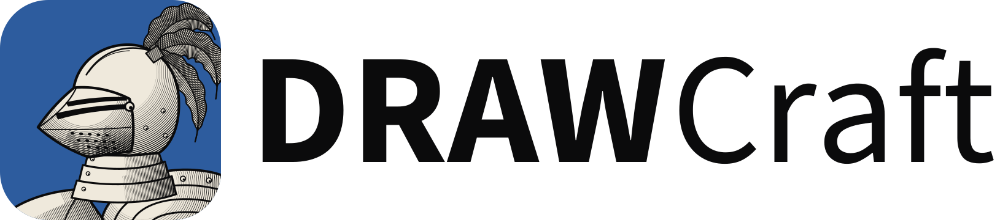

<p align="center">
  <picture>
    <source media="(prefers-color-scheme: dark)" srcset="docs/images/drawcraft-logo-dark.svg">
    
  </picture>
</p>

<p align="center">
  <b>Open-source vector design for print, signage and cutting, built in pure Rust.</b>
</p>

<p align="center">
  Page layout, drawing, shaping and production output in one app that runs natively on macOS, Windows,
  Linux and FreeBSD, and in the browser via WebAssembly. Built on VectorCraft by the ArtCraft team.
</p>

<p align="center">
  
  
  
  
  
</p>

<p align="center">
  <a href="https://withshalom.github.io/drawcraft/"><b>Try DRAWcraft in your browser</b></a> ·
  <a href="docs/drawcraft-plan.md">The plan</a> ·
  <a href="#status">Status</a> ·
  <a href="#quick-start">Quick start</a> ·
  <a href="#built-on-vectorcraft">Built on VectorCraft</a> ·
  <a href="#license-and-credits">License</a>
</p>

> [!NOTE]
> **DRAWcraft is a fork.** It's [VectorCraft](https://github.com/storytold/vectorcraft), the ArtCraft team's
> open-source vector illustration app, grown in a new direction by [WithShalom Studios](https://github.com/withshalom).
> It is not made, endorsed or supported by the ArtCraft team, and it is not affiliated with Corel. CorelDRAW,
> Illustrator and the other product names here are their owners' trademarks, used only to say which files and
> workflows DRAWcraft works with.

## What DRAWcraft is for

VectorCraft follows the workflow of an illustration app: one canvas, artboards, live appearance. DRAWcraft keeps
all of that, and every file VectorCraft reads and writes, and adds the things a sign shop, a laser or vinyl
cutter, an engraver or a print shop reaches for in apps like CorelDRAW:

- **Pages and master layers:** multi-page documents, a page sorter, layers shown on every page.
- **CorelDRAW files:** `.cdr` opened as editable pages, layers and objects.
- **Shaping and containers:** weld, trim, intersect and boundary as one-click commands; art placed inside a shape
  and edited there.
- **Production output:** cut contours, hairlines, plotter and cutter output (PLT/HPGL), laser and engraving
  output, print merge, barcodes, bleed and marks.
- **Dimensions and connectors** that stay attached to the art they measure or join (the dimension tool and DXF
  output come from VectorCraft and are already in).
- **A familiar workspace:** an optional layout and shortcuts for people coming from CorelDRAW, beside VectorCraft's
  own.

How and in what order is in [**the plan**](docs/drawcraft-plan.md). Corel's software is never run, inspected or
copied: the clean-room rule in [`AGENTS.md`](AGENTS.md) covers it as it covers Adobe's.

## Try it in your browser

The web build is published to **<https://withshalom.github.io/drawcraft/>** from `main` (and the `web` branch)
by `.github/workflows/web-deploy.yml`, on every push there. It runs entirely in the browser (WebGPU, with WebGL2 as
the fallback); files you open stay on your machine. Use a current Chrome, Edge, Firefox or Safari.

## A look around

These screenshots are of VectorCraft, which today's DRAWcraft matches feature for feature.

<table>
<tr>
<td width="50%" valign="top">
  
  <p align="center"><sub><b>Live Blends and Layers</b>: editable key paths, smooth colour, every object a row</sub></p>
</td>
<td width="50%" valign="top">
  
  <p align="center"><sub><b>Pen and Direct Selection</b>: real Bézier anchors and handles, plus a contextual task bar</sub></p>
</td>
</tr>
<tr>
<td width="50%" valign="top">
  
  <p align="center"><sub><b>Dimension tool</b>: lengths, angles and radii that follow the art they measure · <code>examples/bracket-drawing.vectorcraft</code></sub></p>
</td>
<td width="50%" valign="top">
  
  <p align="center"><sub><b>Multiple artboards, light theme</b>: Pathfinder · Gradient Mesh · live radial Repeat · Envelope Distort · <code>examples/feature-sheet.vectorcraft</code></sub></p>
</td>
</tr>
</table>

## Files

| | Opens | Saves or exports |
|---|---|---|
| **DRAWcraft** `.drawcraft` | yes | yes (the native format) |
| VectorCraft `.vectorcraft` | yes | yes |
| SVG / SVGZ, PDF (PDF/X), EPS, DXF, EMF / WMF | yes | yes |
| Illustrator `.ai` | yes (the PDF part and the structure of the editing data) | yes (PDF-compatible, or legacy version 7 with layers and groups) |
| PSD / PSB, PNG, JPEG, GIF, BMP, TIFF, Targa, WebP | yes | PNG, JPEG, WebP, GIF, TIFF, layered PSD |
| Affinity `.af`, `.afdesign`, `.afpub` | yes | no |
| CorelDRAW `.cdr` | **planned** ([plan § 4](docs/drawcraft-plan.md#4-opening-cdr-files)) | no (exports Corel-readable PDF, SVG, EPS, `.ai`, EMF and DXF instead) |

**One format, two names.** `.drawcraft` was VectorCraft's own extension before it was renamed, and every
VectorCraft still opens it. DRAWcraft takes the name back for the same format: a `.drawcraft` file is a
VectorCraft document, so DRAWcraft and VectorCraft open each other's files, and DRAWcraft's additions (pages,
master layers) are extra data that VectorCraft keeps without reading. Details: [file-format-parity.md](docs/file-format-parity.md).

## Why DRAWcraft

- **Fast.** Multithreaded SIMD rendering off the UI thread. 20,000 shapes render in about 27 ms at full retina
  resolution while the interface stays at 120 fps.
- **Exact.** Exact curve booleans (no "cannot perform operation"), unlimited undo by structural sharing,
  property-tested file round trips, and units and precision a CAD user would accept.
- **Open.** A documented native format (JSON), first-class SVG, PDF, EPS and DXF, and no lock-in: every file
  saves to formats other apps read.
- **Agent-native.** Every menu item, tool gesture, panel and dialog can be driven over a JSON control channel and an
  **MCP server**, so Claude and other agents can draw, edit and export the way a person does.
- **Everywhere.** One codebase for the desktop apps and the same UI in the browser.

## Quick start

```sh
git clone -b drawcraft https://github.com/withshalom/drawcraft
cd drawcraft

cargo run --release -p vectorcraft                          # desktop app
cargo run --release -p vectorcraft -- examples/dusk-poster.vectorcraft
cargo run --release -p vectorcraft -- --control 7979        # + JSON control channel
cargo run --release -p vectorcraft-cli -- mcp               # MCP server (stdio)
cargo run --release -p vectorcraft-cli -- run --in examples/ribbons.vectorcraft --export out.pdf   # headless batch
cd apps/vectorcraft-web && trunk build --release            # web build → dist/web
cargo xtask ci                                            # fmt, clippy, tests, layering, wasm, vendor names
```

The crates, binaries and packages keep VectorCraft's names (`vectorcraft-*`) so that DRAWcraft can keep merging
VectorCraft's work; the product name, icon and file extension are DRAWcraft's. Fonts, graphics processors, Wayland
and Windows 7: see [`docs/development.md`](docs/development.md).

### Use it from Claude Code and other agents

```sh
claude mcp add drawcraft -- /path/to/vectorcraft-cli mcp
claude mcp add drawcraft -- /path/to/vectorcraft-cli mcp --automation-read-root /work/project --automation-write-root /work/project
```

The details are in [`docs/mcp.md`](docs/mcp.md) and [`docs/control-protocol.md`](docs/control-protocol.md).

## Status

**DRAWcraft is at its start (2026-10-29).** It is VectorCraft with DRAWcraft's name, icon and file extension,
a web build, the clean-room and naming rules for Corel's software, and two layouts:

- **Illustrate** (the default): VectorCraft's Illustrator-style layout, unchanged.
- **Draw**: a page-based layout. Switch with **Illustrate | Draw** at the top right, or Window › Mode. Draw shows the
  Control bar and the rulers, puts Layers in front, adds a **page bar** at the bottom (page navigation, Add Page, a
  tab per page: click to go, double-click to rename, drag to reorder, right-click to insert, move or delete) and a
  **swatch strip** at the right edge (click a colour for the fill, right-click for the stroke).

Pages are artboards in a page order, and a layer can be a master layer whose art repeats on every page in export,
print and on the canvas (search the command palette for "Master Layer"). The Layers panel's master-layer marks, a
Pages panel and a Layout menu come next, then `.cdr` reading on the `cdr` branch. What's built and what's next are
in [the plan](docs/drawcraft-plan.md#7-whats-built) and in the vectorcraft repo's `docs/draw-mode.md`.

Everything inherited from VectorCraft is where VectorCraft is: **alpha**, with about 88% of an illustration app's
menu items, tools, effects and formats present and feature depth around 75% (VectorCraft's own, self-assessed
numbers in [ROADMAP.md](ROADMAP.md) and [docs/target-app-parity.md](docs/target-app-parity.md); the ranked gaps
are in [docs/gaps.md](docs/gaps.md)). Exchanging `.ai` files with Illustrator users is the weakest everyday area:
layer structure can come in wrong in real files, and Illustrator's private editing data isn't written.

Agent and contributor rules (clean-room for Adobe and Corel software, the asset policy, no panics in shipped
code, quality gates) are in [`AGENTS.md`](AGENTS.md). Every bundled asset is listed with its licence in
[`ASSETS.md`](ASSETS.md).

## Built on VectorCraft

DRAWcraft would not exist without [VectorCraft](https://github.com/storytold/vectorcraft) and the
[ArtCraft](https://getartcraft.com/) team's other Crafting Apps, whose engine, renderer, file formats and
interface it inherits. DRAWcraft merges VectorCraft's `main` regularly. Its features (pages and master layers,
draw-mode tools and layout, dimensioning, `.cdr` files) are built in VectorCraft's own terms on the
[`draw-mode`](https://github.com/withshalom/vectorcraft/tree/draw-mode) and
[`cdr`](https://github.com/withshalom/vectorcraft/tree/cdr) branches of
[withshalom/vectorcraft](https://github.com/withshalom/vectorcraft), to be offered to VectorCraft as pull requests,
and merged here under DRAWcraft's name. If you want the illustration app itself, use VectorCraft.

## License and credits

DRAWcraft, like VectorCraft, is dual-licensed under [MIT](LICENSE-MIT) or [Apache-2.0](LICENSE-APACHE), at your
option. Copyright (c) 2026 ArtCraft Team and the VectorCraft contributors, and the DRAWcraft contributors.
Required notices are in [NOTICE](NOTICE).

Bundled fonts, icons, images and other assets keep their own open licenses; each one is listed with its author,
source and license in [ASSETS.md](ASSETS.md).

The app icon (an engraved knight's helm on DRAWcraft blue, `#2d5c9e`) is original artwork for DRAWcraft, generated
in code by [`packaging/knight-icon.py`](packaging/knight-icon.py); its palette and files are in
[`assets/app-icon/`](assets/app-icon/README.md).

The ArtCraft name, wordmark and logos are trademarks of the ArtCraft Team. Under
[`docs/brand/LICENSE-brand.txt`](docs/brand/LICENSE-brand.txt), forks must remove them, so DRAWcraft doesn't show
them; the files stay in `docs/brand/` only because they are upstream's.
